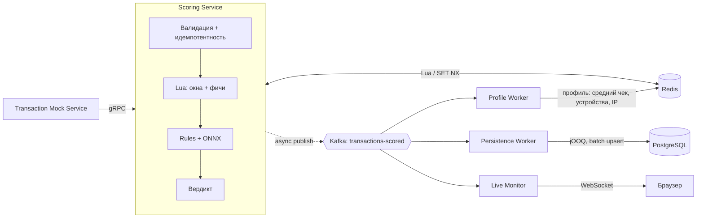

# Anti-Fraud & Risk Engine — архитектура

Система оценивает финансовые транзакции в реальном времени. Online-путь занимает меньше 30 мс, результат — вердикт `ALLOW` / `FLAG` / `BLOCK`. Решения в реальном времени транслируются в браузер через WebSocket.

## 1. Общая схема



Сплошные стрелки лежат на синхронном пути, пунктир — асинхронная публикация. Всё, что ниже Kafka, не влияет на время ответа.

## 2. Принятые решения

| # | Вопрос | Решение | Почему |
|---|--------|---------|--------|
| 1 | Как транзакции попадают в скоринг | **Моковый сервис** вызывает Scoring по **gRPC** | Синхронный запрос-ответ — это то, что меряется SLA 30 мс. k6 бьёт в тот же endpoint |
| 2 | Когда обновляются скользящие окна | **Синхронно в Lua-скрипте** на online-пути. Асинхронная часть остаётся (см. раздел 4) | Асинхронное обновление окон пропускает серию быстрых транзакций, ради которой velocity check и существует |
| 3 | Структура | **Модульный монолит**: один Gradle-проект, каждый сервис — отдельный модуль и контейнер | Выглядит как микросервисы, поддерживается как один проект |
| 4 | Фреймворк и языки | **Spring Boot, Java и Kotlin** | Скоринг и аудит на Java, корутины и Flow в Kotlin-сервисах |
| 5 | Redis недоступен | **Скоринг без Redis-фич**, ответ помечается `degraded=true` | Сервис продолжает работать, деградация видна в метриках |
| 6 | Идемпотентность | **Redis `SET NX` + TTL** на online-пути, **upsert в Postgres** как итоговая запись | Быстрая дедупликация плюс надёжность при потере Redis |
| 7 | Доступ к БД | **jOOQ** | Типобезопасный SQL, полный контроль над запросами к партиционированной таблице |
| 8 | Медленный WS-клиент | **Conflation**: клиенту уходит последнее актуальное состояние, промежуточные обновления пропускаются | Клиент не тормозит сервер и не копит бесконечный буфер |
| — | Использование WebSocket | **Сервер: Live Monitor** (лента решений в браузер) | Fan-out, backpressure, наглядное демо |
| 9 | Стиль Spring | **WebFlux**, корутины в Kotlin-сервисах | Модель выполнения задач Java-сервисов уточняется на этапах реализации |
| 10 | WebSocket в Spring | **Reactive `WebSocketHandler`** (без STOMP) | Backpressure и conflation видны и реализуются руками |
| 11 | Kafka-клиент | **spring-kafka** (выбор оставлен на меня) | В 4.x поддерживает `suspend`-листенеры; retry-топики и DLT из коробки (`@RetryableTopic`), не нужно писать их вручную |
| 12 | Скоринг без Redis | **Облегчённая ONNX-модель** на фичах только из самой транзакции | Модель остаётся в деле, а не выключается целиком |
| 13 | Источник транзакций | **Моковый сервис с заложенными фрод-паттернами** | Заранее известно, какие транзакции фродовые, значит можно посчитать precision/recall системы |
| 14 | Версии | **JDK 25, Spring Boot 4, Kotlin 2.x** | — |
| 15 | gRPC в Spring | **Официальный Spring gRPC**: в Boot 4.1 встроен как `spring-boot-starter-grpc-server` | Единственный поддерживаемый вариант под Boot 4 |
| 16 | Фрод-паттерны мока | **Пять паттернов из раздела 9** (выбор оставлен на меня) | Каждый ловится своим слоем системы |

## 3. Online-путь (синхронный)

| Шаг | Что происходит | Бюджет |
|-----|----------------|--------|
| 1 | gRPC-запрос, валидация | ~2 мс |
| 2 | Lua проверяет `idem:{txId}` и возвращает готовый вердикт или резервирует ID, чтобы только один запрос изменил окна | ~1 мс |
| 3 | Lua-скрипт: `ZADD` транзакции в окна, `ZREMRANGEBYSCORE` старых записей, чтение агрегатов и профиля. Один запрос к Redis | ~3 мс |
| 4 | Rules + ONNX-инференс в памяти процесса | ~10 мс |
| 5 | Сохранение вердикта и ответ по gRPC | ~1 мс |
| 6 | Публикация в Kafka без ожидания подтверждения | 0 мс на пути |
| | **Итого (цель)** | **< 30 мс, запас ~13 мс** |

Scoring вызывает Redis через асинхронный Lettuce с общим бюджетом 5 мс на резервирование, Lua и ожидание сохранения вердикта. Вычисление риска не расходует остаток этого бюджета. Если признаки не получены вовремя или circuit breaker открыт, сервис использует облегчённую модель и R6 и помечает ответ `degraded=true`. Если истёк бюджет ожидания записи, клиент получает рассчитанный вердикт. Запись в Redis ещё может завершиться, и сохранённый ответ тогда совпадёт с выданным. Circuit breaker учитывает сбои чтения и записи. Он оценивает до 10 вызовов, открывается при 80% сбоев после минимум 5 вызовов и через 1 с разрешает до 3 пробных вызовов.

Каждое правило R1–R6 реализует общую стратегию. В нормальном режиме Scoring объединяет оценки полной модели и правил с весами 0,90 и 0,10. R6 блокирует независимо от модели. Две CPU-сессии ONNX загружаются из ресурсов JAR при старте и работают в отдельном пуле из двух потоков с очередью на 64 задачи. При заполнении очереди новый запрос получает gRPC `RESOURCE_EXHAUSTED`. Новые модели входят в сборку и вступают в силу после перезапуска. Время выполнения шага ML измеряется таймером `scoring.step.duration{step=ml}` без ожидания в очереди.

## 4. Асинхронная часть

Три независимые consumer group читают `transactions-scored`:

| Consumer | Что делает | Почему асинхронно |
|----------|-----------|-------------------|
| **Persistence Worker** | Батчами пишет аудит в Postgres (upsert по `transaction_id`), метки мока из `transactions-labels`, отдаёт REST аудита и качества | Запись в БД — самый медленный шаг, ответ ждать не должен |
| **Profile Worker** | Обновляет «медленный» профиль в Redis: средний чек (EMA), известные устройства и IP, типичное гео | Профиль меняется плавно, лаг в секунды не критичен. Разгружает Lua-скрипт на горячем пути |
| **Live Monitor** | Читает решения и рассылает их по WebSocket | Демо и мониторинг |

Надёжность: at-least-once, ручной commit offset после успешной обработки, retry-топик с задержкой, DLQ для «ядовитых» сообщений. Все записи идемпотентны.

**Разделение Redis-данных:**
- **Быстрые окна** (ZSET: velocity за 1, 5 и 60 минут, сумма за окно) обновляются синхронно, в Lua.
- **Медленный профиль** (Hash и Set: средний чек, устройства, IP) обновляется асинхронно, в Profile Worker.

## 5. Live Monitor (WebSocket)

```
Kafka consumer → StateFlow<MonitorState> ─┬→ клиент 1 (conflate) → WS
                                          ├→ клиент 2 (conflate) → WS
                                          └→ клиент N ...
```

- **Состояние** (`MonitorState`): счётчики ALLOW/FLAG/BLOCK, RPS, доля degraded, последние N событий FLAG/BLOCK.
- **Conflation (решение 8):** каждый клиент получает последнее состояние, когда готов принять. Если клиент не успевает, промежуточные версии пропускаются, и клиент видит старые данные, пока не догонит.
- **Фронтенд:** одна HTML-страница на чистом JS.

## 6. Модули Gradle

```
anti-fraud/
├── buildSrc/             # общие настройки сборки (convention-плагины)
├── proto/                # .proto-контракты, генерация стабов для Java и Kotlin
├── scoring-service/     # Java: gRPC, Redis/Lua, rules, ONNX
├── persistence-worker/  # Java: Kafka → Postgres (jOOQ)
├── profile-worker/      # Kotlin: Kafka → Redis-профиль
├── live-monitor/        # Kotlin: Kafka → WebSocket + статическая страница
├── transaction-mock/    # Kotlin: генератор транзакций и gRPC-клиент
├── ml/                   # Python: обучение full- и lite-модели, экспорт в ONNX, метрики
├── load-tests/           # k6-сценарии
└── infra/                # docker-compose, Prometheus, Grafana
```

## 7. Хранилища и контракты

**Kafka-топики:** события скоринга идут в transactions-scored с ключом user_id, чтобы сохранить порядок для пользователя. Метки мока идут в transactions-labels с ключом transaction_id. Оба сообщения используют Protobuf из events.proto. Для ошибок записи в PostgreSQL предусмотрены transactions-scored.retry и transactions-scored.dlq.

**Redis-ключи** (hash tag `{userId}` держит все ключи пользователя в одном слоте Redis Cluster, иначе Lua-скрипт не сможет работать с ними вместе. ID со скобками или начальным `~` кодируются в Base64URL с префиксом `~`):
- `win:{userId}` — ZSET, score = timestamp, member = `txId:amountMinor`
- `small:{userId}` — ZSET мелких транзакций (score = timestamp, member = `txId:merchantId`) для card testing
- `last:{userId}` — Hash: гео и время последней транзакции (обновляется в Lua, нужен для impossible travel)
- `prof:{userId}` — Hash: средний чек (EMA, α = 0,1) и число транзакций, обработанных Profile Worker
- `dev:{userId}`, `ip:{userId}`, `cty:{userId}` — Set из 20 последних уникальных значений. Списки `dev-recent:{userId}`, `ip-recent:{userId}`, `cty-recent:{userId}` хранят порядок по последнему использованию
- `profile-seen:{userId}:txId` — дедупликация обновлений профиля, TTL 24 ч. Profile Worker обновляет профиль и маркер в одном Lua-скрипте, пропуская `BLOCK`
- `feature-seen:{userId}:txId` — ключ дедупликации обновления окон, TTL 24 ч
- `idem:{txId}` — сохранённый вердикт, TTL 24 ч
- `idem-user:{txId}` связывает ID с пользователем до сохранения вердикта, TTL 24 ч. `idem-lease:{txId}` резервирует первую попытку записи на 1 с. При сохранении вердикта Lua удаляет обе записи.

**PostgreSQL:** `transaction_audit`, партиционирование по месяцам (`PARTITION BY RANGE (created_at)`), уникальность по `(transaction_id, created_at)`.

## 8. Отказы компонентов

| Что упало | Поведение |
|-----------|-----------|
| Redis | Облегчённая модель + R6, `degraded=true`. Кэш Redis временно недоступен. Идемпотентность записи аудита обеспечит Postgres upsert на этапе 5 |
| Kafka | Ответ отдаётся как обычно. Публикация идёт в ограниченный буфер, при переполнении — метрика потерь |
| Postgres | Persistence Worker перестаёт коммитить offset, сообщения копятся в Kafka и дописываются после восстановления |
| ONNX-модель | Ошибка инференса даёт решение доступных правил, `degraded=true`, `model_version=rules-only`. При недоступной или несовместимой модели в JAR запуск завершается ошибкой |
| WS-клиент медленный | Conflation, сервер не блокируется |

## 9. Моковый сервис транзакций

Отдельный модуль. Генерирует пользователей с «нормальным» поведением и подмешивает фрод-паттерны. Каждая транзакция несёт скрытую метку `expected_fraud` и имя паттерна. В Scoring метка не уходит, а пишется в отдельный Kafka-топик `transactions-labels`. Сравнение меток с вердиктами даёт precision и recall всей системы, а не только модели.

### Нормальные пользователи

- Пул из ~10 000 пользователей, у каждого стабильный профиль: домашняя страна, 1–2 устройства, 1–3 IP.
- Сумма — логнормальное распределение вокруг персонального среднего чека.
- Каждый профиль получает воспроизводимую частоту от 1 до 20 платежей за условный день. Для каждого обычного платежа мок независимо выбирает пользователя с вероятностью, пропорциональной его частоте (D-34). Моменты отправки определяет общий ограничитель RPS. Такое распределение воспроизводит относительную активность пользователей в демо, где длительность условного дня зависит от темпа потока.
- Изредка бывают легитимные отклонения (покупка в поездке, новый телефон), чтобы система не получала идеально чистый фон. Без них precision выглядит нереалистично хорошим.
- Поездка начинается с первой покупки за рубежом. Пока она активна, обычные платежи пользователя используют одну страну и координаты. Первый платёж после окончания проходит дома. Длительность задаёт `mock.generation.trip-duration` (по умолчанию 30 минут). Состояние принадлежит одному запуску генерации, а все платежи в поездке сохраняют легитимную метку (D-35).

### Фрод-паттерны

Доля фрода около 1–2 % от потока, настраивается.

| Паттерн | Как выглядит | Чем ловится | Слой |
|---------|--------------|-------------|------|
| **Velocity burst** | 10–20 транзакций одного пользователя за 30–60 секунд | Число транзакций в окне 1 мин и 5 мин | Lua-окна (синхронно) |
| **Account takeover** | Новое устройство + новый IP + другая страна, сумма из обычного распределения пользователя; с настраиваемой вероятностью через 1–3 минуты следует крупный платёж (D-30). Атака без крупного платежа также имеет фродовую метку | Флаги «новое устройство», «новый IP», «новая страна» + сумма относительно среднего. Обнаружение варианта без крупной суммы и защита профиля от быстрого запоминания новых атрибутов требуют проработки на этапах 3–5 | Профиль (асинхронно) + правила |
| **Card testing** | 5–15 мелких сумм (до $2) у разных мерчантов за несколько минут, затем крупная | Число мелких транзакций в окне, число уникальных мерчантов | Lua-окна (`small:{userId}`) |
| **Amount anomaly** | Одна сумма в 10–50 раз выше среднего чека, остальное привычно | Отношение суммы к среднему чеку | Профиль + ML |
| **Impossible travel** | Две транзакции из стран в тысячах км друг от друга с интервалом в минуты | Скорость перемещения = расстояние / время между транзакциями | Lua (`last:{userId}`) + правила |

Паттерны специально распределены по разным слоям. Так в демо и в отчёте видно, что делает каждая часть системы: окна, профиль, правила, модель.

### Режимы

- **Поток:** `PUT /api/v1/mock/stream` запускает поток или меняет его настройки, `GET` показывает состояние, `DELETE` останавливает отправку. Ограничитель RPS задаёт темп попыток. При заполнении лимита одновременных gRPC-вызовов очередная транзакция отбрасывается и учитывается в `dropped` (D-32). Ошибки уже отправленных вызовов учитываются в `errors`. Многошаговые паттерны сохраняют запланированные интервалы между платежами. При изменении доли фрода или набора паттернов запланированные продолжения сбрасываются.
- **Сценарий:** запуск одного паттерна по команде, чтобы показать в Live Monitor, как он блокируется.
- **Датасет:** `POST /api/v1/mock/datasets` использует тот же генератор обычных платежей и фродовых сценариев с виртуальным временем и выдаёт CSV порциями. Экспорт не зависит от Scoring и Redis. По одному seed и настройкам можно повторить файл. `features-core` считает окна по платежам, включая текущий. Признаки профиля вычисляются по истории до текущего платежа. Профиль обновляется сразу по каждой строке. Сравнение с Redis/Lua и асинхронным профилем предусмотрено при подключении online-фич.
